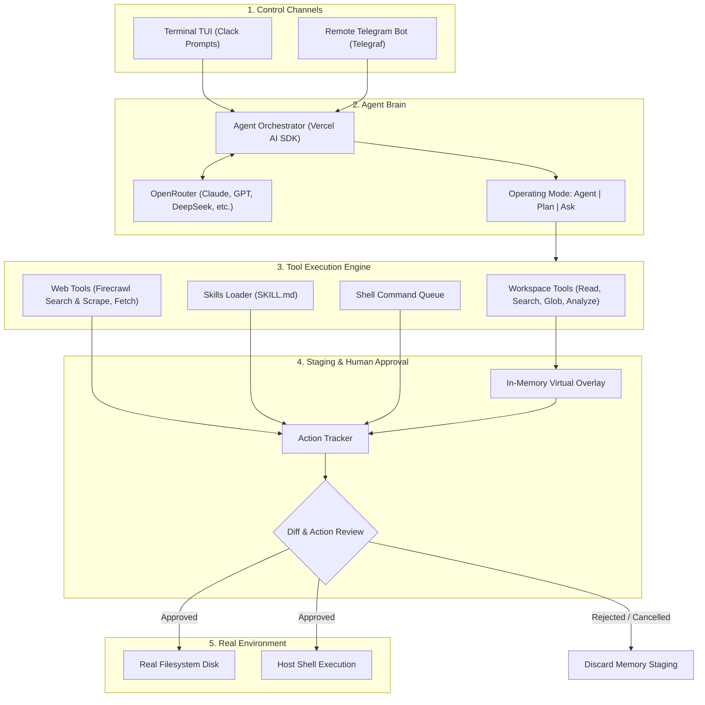

# Devagent — Self-Hosted Personal AI Agent & Automation Platform

> An autonomous, local-first personal AI agent and execution harness that bridges your machine, terminal, messaging channels, filesystem, shell, and live web intelligence into a single self-hosted platform.

[](https://bun.sh/)
[](https://www.typescriptlang.org/)
[](https://sdk.vercel.ai/)
[](https://openrouter.ai/)
[](https://telegram.org)
[](LICENSE)

---

## What is devagent?

**devagent** is not merely an inline code-completion plugin or a passive chat assistant. It is a **full-fledged, self-hosted personal AI agent and remote execution platform** designed to run directly on your workstation, homelab server, or cloud VPS.

It transforms your machine into an autonomous computing hub. With `devagent`, you can issue high-level directives from your terminal using an interactive, styled TUI, or remotely from anywhere in the world using **Telegram**. 

Once assigned a task, `devagent` autonomously plans, searches the web, navigates and analyzes your workspace, executes terminal commands, drafts multi-file code modifications, and manages complex workflows.

### The Safety-First Core: In-Memory Virtual Overlay

Most autonomous agents suffer from a critical flaw: they blindly execute destructive edits directly onto disk. `devagent` eliminates this risk by introducing an **in-memory virtual filesystem overlay**:
- All proposed file changes, additions, and deletions are intercepted and staged in virtual memory.
- The agent reads and iterates on its own staged changes in real time without touching your repository.
- Nothing is applied to your actual disk until you inspect and approve a unified diff — either through interactive terminal prompts or Telegram inline buttons.

---

## Why devagent? (Pros & Advantages)

| Advantage | Why It Matters |
| :--- | :--- |
| 🛡️ **Zero Blind Writes** | In-memory staging guarantees that no file is overwritten or deleted without human verification and unified diff approval. |
| 📱 **Remote Control from Anywhere** | Run, monitor, and approve tasks directly from your smartphone via Telegram without needing SSH or a laptop. |
| 🧭 **Plan-Before-Execute Separation** | Avoid chaotic agent loops with Plan Mode: generate a structured, Zod-validated plan first, then choose precisely which steps to execute. |
| 🌐 **Live Web Intelligence** | Integrated with Firecrawl and HTTP fetch tools to search Google/web sources, scrape documentation into Markdown, and inspect live APIs. |
| 🧩 **Extensible Skills System** | Supports `SKILL.md` custom skill definitions (compatible with Claude and Cursor skill formats) to teach the agent custom project workflows. |
| ⚡ **Model Independence** | Powered by the Vercel AI SDK and OpenRouter. Switch between Claude 3.5 Sonnet, GPT-4o, DeepSeek, Llama 3, or free-tier models with a single environment variable. |
| 🚀 **High-Performance Runtime** | Built from the ground up on Bun and TypeScript for near-instant boot times and minimal resource overhead. |

---

## Impact Created by devagent

### 1. Unchaining Developers from Their Desks
By integrating Telegram as a first-class control interface, `devagent` frees you from your workstation. You can kick off a complex refactoring task, research an architectural problem, or execute multi-step deployment plans while commuting or away from your computer, reviewing diffs and granting execution approvals with a single tap on your phone.

### 2. Eliminating "Agent Anxiety"
Developers often hesitate to give autonomous agents write permissions for fear of corrupted files, lost work, or broken git histories. `devagent`'s virtual overlay isolates all actions until explicit human sign-off, making autonomous agents practical and safe for production codebases.

### 3. Bridging Local System Power with Web Context
Unlike web-based AI platforms that lack access to your local environment, or isolated CLI tools that lack broader web awareness, `devagent` unites both: it can scrape the latest library documentation from the internet, search for solutions, and immediately apply the exact changes to your local project files.

---

## Architecture & How It Works



---

## Operating Modes

`devagent` features three distinct cognitive modes, accessible from both the CLI and Telegram:

### 1. Agent Mode (Autonomous Problem Solver)
For end-to-end task execution, bug investigation, and feature building.
- Runs an autonomous tool loop (configured up to 40 steps).
- Explores files, searches codebase patterns, reads documentation, and stages multi-file changes.
- Queues necessary shell commands for post-approval execution.
- Generates a full unified diff summary for approval before touching the disk.

### 2. Plan Mode (Architectural Planner & Selective Execution)
Prevents premature execution by breaking problems into two distinct phases:
- **Phase 1 — Deep Research & Synthesis:** The agent reads relevant codebase files and queries the web, synthesizing a structured plan validated against a strict Zod schema. Each step includes a title, description, complexity rating (`low`, `medium`, `high`), and tactical hints.
- **Phase 2 — Interactive Execution:** Presents an interactive checklist (multiselect in CLI, button matrix in Telegram). You select which steps to execute; the agent runs only the approved steps with full staging and diff review.

### 3. Ask Mode (Zero-Risk Knowledge & Q&A)
For codebase onboarding, code reviews, and technical exploration.
- Read-only tools only: file reading, glob search, codebase structure analysis, and web search.
- Modification, deletion, and shell execution are strictly disabled.
- Includes a built-in feature to export answers and architectural breakdowns directly to a Markdown report (e.g. `ask.md`).

---

## Remote Telegram Control

Turn your machine or server into a 24/7 personal assistant reachable from any device.

### Supported Commands

| Command | Action |
| :--- | :--- |
| `/start` | Displays the bot status, capabilities, and active owner info. |
| `/agent <task>` | Launches an autonomous multi-step agent workflow. Streams status updates and sends inline diff approvals. |
| `/plan <goal>` | Generates a structured multi-step plan with interactive inline toggle buttons (`[Toggle Step]`, `[Select All]`, `[Proceed]`). |
| `/ask <question>` | Researches your question against the codebase and web, delivering formatted Markdown responses. |

### Interactive Telegram Session Controls
- **Interactive Checklists:** Tap inline buttons to select or deselect specific plan steps.
- **Diff Inspection:** Hit `[📋 Show Diff]` to view unified patches formatted for mobile screens.
- **One-Tap Approvals:** Approve or reject staged changes with `[✅ Approve]` or `[❌ Reject]`.
- **Owner-Locked Security:** Enforces strict authorization via `TELEGRAM_OWNER_ID` to prevent unauthorized access to your machine.

---

## Built-In Tool Ecosystem

### Workspace & Codebase Tools
- `read_file`: Reads text files with workspace-relative safety checks.
- `modify_file`: Stages whole-file modifications into the in-memory virtual overlay.
- `delete_file`: Stages file removals in the staged deletion registry.
- `create_folder`: Stages directory creation (`mkdir -p`).
- `list_files`: Explores directory trees with optional recursive depth.
- `search_files`: Powerful glob-pattern matching (`*.ts`, `**/*.md`) with content substring filtering.
- `analyze_codebase`: Summarizes directory structure, file counts, sizes, and file extension breakdowns.
- `execute_shell`: Queues workspace commands to be executed post-approval.

### Web Intelligence Tools
- `web_search`: Live search powered by Firecrawl, returning ranked results with titles, URLs, and snippets.
- `web_crawl`: Scrapes any public URL and converts the page into structured Markdown.
- `fetch_url`: Makes direct HTTP GET requests to inspect raw APIs and endpoints.

### Custom Skills System
- `list_skills` & `read_skill`: Scans paths defined in `SKILLS_DIRS` for custom `SKILL.md` files (compatible with Claude Code and Cursor skill formats), empowering the agent with project-specific rules, scripts, and deployment recipes.

---

## Tech Stack

| Layer | Technology |
| :--- | :--- |
| **Runtime & Package Manager** | [Bun](https://bun.sh/) (native TypeScript execution, high-performance package manager) |
| **Agent Framework** | [Vercel AI SDK](https://sdk.vercel.ai/) (`ToolLoopAgent`, `generateText`, structured tool loops) |
| **Model Hub & Routing** | [OpenRouter](https://openrouter.ai/) (access to Claude, GPT-4o, DeepSeek, Gemini, etc.) |
| **Schema Validation** | [Zod](https://zod.dev/) (runtime validation of tool inputs and structured plans) |
| **Terminal TUI** | `@clack/prompts`, `chalk`, `figlet`, `marked-terminal` |
| **Diff Generation** | `diff` (unified diff calculation) |
| **Remote Messaging Engine** | [Telegraf](https://telegraf.js.org/) (Telegram Bot API framework) |
| **Web Research** | [@mendable/firecrawl-js](https://www.firecrawl.dev/), native `fetch` |

---

## Getting Started

### Prerequisites

1. **[Bun](https://bun.sh/)** installed on your system:
   ```bash
   # macOS / Linux
   curl -fsSL https://bun.sh/install | bash

   # Windows PowerShell
   powershell -c "irm bun.sh/install.ps1 | iex"
   ```
2. An **[OpenRouter](https://openrouter.ai/)** API key.
3. *(Optional)* A **[Firecrawl](https://firecrawl.dev/)** API key for web search and scraping.
4. *(Optional)* A **Telegram Bot Token** (from [@BotFather](https://t.me/BotFather)) and your **Telegram User ID** (from [@userinfobot](https://t.me/userinfobot)) for remote Telegram control.

### Installation

Clone the repository and install dependencies using Bun:

```bash
git clone <repository-url>
cd devagent
bun install
```

### Environment Configuration

Create a `.env` file in the project root:

```env
# Required: LLM Provider Key
OPENROUTER_API_KEY=your_openrouter_api_key

# Optional: Default model (defaults to openrouter/free if omitted)
OPENROUTER_DEFAULT_MODEL=anthropic/claude-3.5-sonnet

# Optional: Web Research & Crawling
FIRECRAWL_API_KEY=your_firecrawl_api_key

# Optional: Remote Telegram Control
TELEGRAM_BOT_TOKEN=your_telegram_bot_token
TELEGRAM_OWNER_ID=your_telegram_numeric_user_id

# Optional: Custom Skill Directories (separated by semicolons or colons)
SKILLS_DIRS=./skills;D:/my-custom-skills
```

#### Environment Variables Reference

| Variable | Required | Description |
| :--- | :---: | :--- |
| `OPENROUTER_API_KEY` | **Yes** | Authenticates model inference requests via OpenRouter. |
| `OPENROUTER_DEFAULT_MODEL` | No | Model ID to use (e.g., `anthropic/claude-3.5-sonnet`, `openai/gpt-4o`). |
| `FIRECRAWL_API_KEY` | No | Enables live web search and webpage crawling. |
| `TELEGRAM_BOT_TOKEN` | No | Connects the remote Telegram bot controller. |
| `TELEGRAM_OWNER_ID` | No | Restricts Telegram bot execution exclusively to your user ID. |
| `SKILLS_DIRS` | No | Paths to directories containing custom `SKILL.md` skill files. |

---

## How to Start & Use

### 1. Launching devagent

Start the application using the wakeup command:

```bash
bun run index.ts wakeup
# or if globally linked:
devagent wakeup
```

The system displays the styled banner and prompts you to select your interface:
- **CLI:** Launches the terminal menu for Agent, Ask, or Plan mode.
- **Telegram:** Starts the always-on Telegram bot harness.

### 2. Terminal CLI Walkthrough

```text
? Which mode do you want to proceed with? › CLI
? Select a mode: › Agent Mode

? What would you like the agent to do?
› Create a rate limiter middleware for our Express server and add tests

  ✓ analyze_codebase {"path":"."}
  ✓ read_file {"path":"src/server.ts"}
  ✓ modify_file {"path":"src/middleware/rate-limiter.ts"}
  ✓ modify_file {"path":"src/server.ts"}
  ✓ modify_file {"path":"tests/rate-limiter.test.ts"}

Unified Diff Review:
--- src/server.ts
+++ src/server.ts (staged)
@@ -10,2 +10,4 @@
+import { rateLimiter } from "./middleware/rate-limiter";
+app.use(rateLimiter({ max: 100, windowMs: 60000 }));

? Apply these changes to your workspace? (Yes / No)
```

### 3. Remote Telegram Walkthrough

1. Run `devagent wakeup` and choose **Telegram**.
2. Open Telegram on your phone and send:
   ```text
   /plan Add Docker and Docker Compose support for production deployment
   ```
3. The bot responds with a plan breakdown and an inline button grid:
   ```text
   📋 Plan for: Add Docker support
   
   ✅ 1. Create optimized multi-stage Dockerfile [medium]
   ✅ 2. Create docker-compose.yml with health checks [low]
   ✅ 3. Add .dockerignore to exclude node_modules and .env [low]
   ✅ 4. Add docker:build script to package.json [low]
   
   [ Toggle 1 ] [ Toggle 2 ]
   [ Toggle 3 ] [ Toggle 4 ]
   [ ✅ Select All ] [ ⬜ Deselect All ]
   [ 🚀 Proceed ]
   ```
4. Tap steps to toggle them, tap `[ 🚀 Proceed ]`, review the generated diff right on your mobile screen, and hit `[ ✅ Approve ]` to apply.

---

## Custom Skills System

Extend the agent's intelligence with custom, domain-specific skills. Place a `SKILL.md` file anywhere in your repository or in an external directory referenced by `SKILLS_DIRS`.

Example skill (`skills/release/SKILL.md`):
```markdown
# Release Skill
When asked to prepare a release:
1. Verify type safety by running `bun run typecheck`.
2. Check that version in `package.json` is bumped.
3. Generate a changelog entry from the git commit history.
```

The agent automatically discovers available skills via `list_skills` and reads their instructions via `read_skill` when addressing related goals.

---

## Security & Operational Boundaries

Running an agent on your local machine requires thoughtful security safeguards:

- **Strict Path Sandboxing:** `resolveSafe()` ensures all filesystem operations are strictly confined within the workspace root, blocking directory traversal attacks (`../`).
- **Sensitive File Protection:** `assertNotExcluded()` prevents reading or editing sensitive files such as `.env`, `.git`, `node_modules`, build artifacts, and system files.
- **In-Memory Staging:** Modifications are held in RAM until explicitly approved; no unverified changes touch your disk.
- **Single-Owner Telegram Locking:** Every incoming message and callback query is validated against `TELEGRAM_OWNER_ID`. Unauthorized users cannot view data or command the bot.
- **Shell Command Verification:** Shell commands queued via `execute_shell` are highlighted during the review phase and only execute upon explicit confirmation.

---

## Project Structure

```text
devagent/
├── ai/
│   ├── ai.config.ts         # OpenRouter provider configuration & environment loader
│   └── index.ts             # AI module exports
├── modes/
│   ├── cli.ts               # Terminal mode selector
│   ├── agent/
│   │   ├── actiontracker.ts  # Action history and staging logger
│   │   ├── agent-tools.ts    # Agent workspace tools definitions
│   │   ├── approval.ts       # CLI diff review and confirmation prompts
│   │   ├── diff-view.ts      # Unified diff formatting engine
│   │   ├── orchestrator.ts   # Multi-step Agent Mode loop (ToolLoopAgent)
│   │   ├── tool-executor.ts  # In-memory virtual overlay & tool execution engine
│   │   └── types.ts          # Agent configuration and action types
│   ├── ask/
│   │   └── orchestrator.ts   # Ask Mode Q&A and markdown report exporter
│   ├── plan/
│   │   ├── orchestrator.ts   # Plan execution coordinator
│   │   ├── planner.ts        # Zod-validated structured planning engine
│   │   ├── selection.ts      # CLI step selection prompt
│   │   ├── types.ts          # Plan schema and step types
│   │   └── webtools.ts       # Firecrawl web search, crawler, and fetch tools
│   └── telegram/
│       ├── agentrun.ts       # Telegram agent execution wrapper
│       ├── approvalsession.ts# Interactive diff approval sessions & inline buttons
│       ├── auth.ts           # Owner ID validation middleware
│       ├── constants.ts      # Welcome text and bot command templates
│       ├── handlers.ts       # Telegram command and callback query handlers
│       ├── index.ts          # Telegraf bot lifecycle manager
│       ├── plansession.ts    # Interactive plan step toggle sessions
│       └── text.ts           # Telegram text formatting and clipping helpers
├── tui/
│   ├── terminal-md.ts        # Styled terminal Markdown renderer
│   └── wakeup.ts             # Figlet shadow banner and interface picker
├── index.ts                  # CLI entrypoint (`devagent wakeup`)
├── package.json              # Package manifest and dependency tree
├── tsconfig.json             # TypeScript compiler configuration
└── README.md                 # Project documentation
```

---

## Development & Verification

To verify the codebase and check for TypeScript errors:

```bash
# Run TypeScript verification via configured script
bun run typecheck

# Direct check with Bun
bun check
```

---

## License

This project is licensed under the [MIT License](LICENSE).
